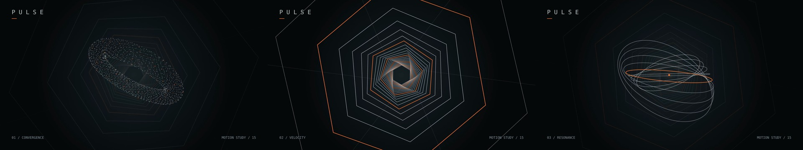

# PULSE · 代码视频首版

15 秒程序动效，全量 Remotion skill，以及从公开源码移植的视差与遮罩小样。

## 直接查看

- [PULSE · 15 秒 MP4](media/pulse-15s.mp4)
- [视差小样 · 6 秒](media/parallax-6s.mp4)
- [遮罩小样 · 4 秒](media/mask-trails-4s.mp4)
- [全量 skill 单文件](dist/remotion-best-practices-full.md)
- [完整可安装 skill 目录](skills/remotion-best-practices)
- [开源案例、原片与复现范围](docs/case-studies.md)



## 运行与导出

准备 Node.js 22 或更新版本、npm，以及 FFmpeg/ffprobe（视频验收用）。首次渲染还需下载 Remotion 对应的 Chrome Headless Shell；首次安装和下载需要网络，之后画面与字体均使用本地文件。

```bash
git clone https://github.com/rkk178460-hue/p.git
cd p/examples/pulse
npm ci
npm run dev
```

打开终端实际打印的 Studio 地址，选择 `Pulse`、`ParallaxStudy` 或 `MaskTrailsStudy`。

```bash
npm run check
npm test
npm run qa
npm run render
npm run render:parallax
npm run render:mask
cd ../..
python scripts/verify_video.py examples/pulse/out/pulse.mp4
python scripts/verify_video.py examples/pulse/out/parallax.mp4 --duration 6
python scripts/verify_video.py examples/pulse/out/mask-trails.mp4 --duration 4
```

输出到 `examples/pulse/out/`，主片为 1920×1080、60 fps、900 帧、H.264、无声。两段附加小样分别 360 帧和 240 帧。无需 API key、付费生成、在线媒体或三维模型。

若已有兼容浏览器，可给渲染命令追加 `--browser-executable=/absolute/path/to/chrome-headless-shell`。内存不足可将 `--concurrency=2` 改为 1。依赖只保证此固定版本；更新时按 skill 的 upgrade 模块核对。

## 使用全量 skill

推荐将整个 `skills/remotion-best-practices` 目录复制到目标代理的 skills 目录，例如项目中的 `.agents/skills/remotion-best-practices`。不要只复制目录里的入口 SKILL.md，它会读取随附参考文件。

需要一个可携带文件时，使用 `dist/remotion-best-practices-full.md`：包含全部文本资源和内嵌附件，内部参考链接已转换为章节链接，可改名为 SKILL.md 使用。需要运行附录中的脚本时，先将对应代码块按记录路径保存为文件。正式工程优先用完整目录。

```bash
python scripts/build_skill.py
python scripts/build_skill.py --check
```

全量版保留已安装的官方 4.0.535 快照、11 个工作流模块、随附代码和素材，以及社区整理和本次 GitHub 实践。SHA-256 与来源提交记在 [manifest](dist/skill-manifest.json)。它是完整参考包，按任务读取章节，不应每次全部塞进上下文。

## 示例结构与扩展

`src/Root.tsx` 注册三个可独立预览的 composition，并等待本地字体。`draw.js` 组合 `scenes/` 中的三个阶段；`palette.js` 集中管理色彩；`motion.js` 提供公共时间和循环运算；`studies.js` 隔离两种移植机制。画布元素作为同一程序模板编辑，不支持逐个粒子的 Studio 源码编辑。

| 时间 | 主片内容 |
| --- | --- |
| 0–5 秒 | 确定性粒子聚成旋转环 |
| 5–10 秒 | 加速穿行六边形隧道 |
| 10–15 秒 | 轨道共振与末尾淡出 |

首次修改从颜色、速度或粒子数开始；通过独立 composition 检查机制。新增实质性场景时拆成独立组件并注册自己的时间轴；需要三维、声音或字幕时按对应官方模块添加，保持 Remotion 包版本一致。

验收见 [标准](docs/acceptance.md) 与 [实际结果](docs/validation.md)。算法与帧参数可复现；不同浏览器、系统或编码器的像素和 MP4 字节不承诺完全相同。

## 来源与许可

本项目自编示例和工具采用 [MIT](LICENSE)。Motion Canvas 的机制来源保留 [MIT 通知](licenses/motion-canvas-MIT.txt)。字体保留 [原许可](licenses/dejavu-font.txt)。官方 Remotion skill 文件保留上游归属；固定快照未提供独立 LICENSE，不能据本项目 MIT 推断其再许可。Remotion 运行时采用自身许可，参考 [核对时的条款](licenses/remotion-runtime-license.md) 与官方当前条款。

本仓库公开发布的是源码、参考资料和本地程序渲染。未复制案例音乐、品牌素材或原视频；案例移植的具体范围见来源记录。
